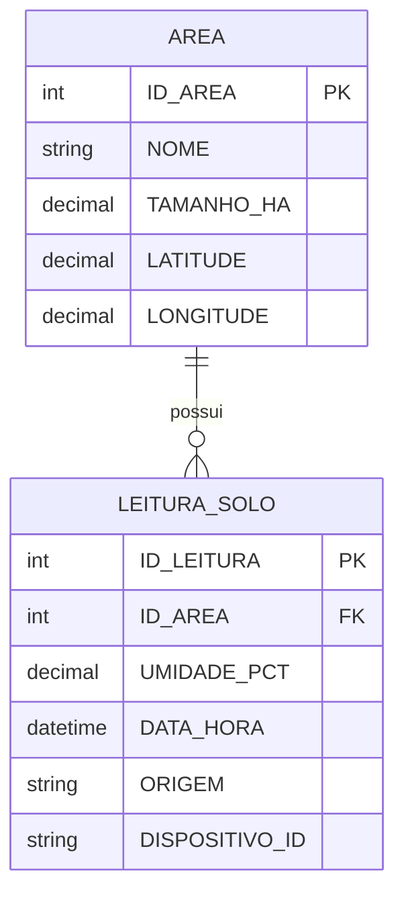

# AgroSync — API .NET

Global Solution 2026 · CitizenTech · Advanced Business Development with .NET

## Integrantes

| Nome | RM |
|---|---|
| Alan Christopher Gonzaga Miranda | 567033 |
| Guilherme Santos Sena | 568101 |
| Igor Dantas da Silva | 568337 |

## Sobre a solução

O AgroSync ajuda pequenos produtores rurais a decidir com base em dados, e
não no achismo. Esta API é o módulo de **monitoramento de solo**: cadastra as
áreas de cultivo e registra leituras de umidade (de sensor ou manuais),
guardando tudo no Oracle da FIAP.

- **Cidadão beneficiado:** pequeno produtor rural.

## Tecnologias

- ASP.NET Core 8 (Web API com controllers)
- Entity Framework Core 8 com Oracle.EntityFrameworkCore
- Oracle Database 19c (oracle.fiap.com.br)
- Migrations versionadas

## Modelo de dados



Uma área tem várias leituras (1:N). Ao excluir uma área, suas leituras são
excluídas em cascata.

## Pré-requisitos

- .NET 8 SDK
- Ferramenta de Migrations: `dotnet tool install --global dotnet-ef --version 8.*`
- Conexão com a internet e o banco da FIAP no ar (`oracle.fiap.com.br:1521`,
  SID `ORCL`), com um RM e senha que possam criar tabelas no próprio schema

## Como executar

Todos os comandos são executados na pasta do repositório (onde está o
`AgroSync.Api.csproj`).

1. Clone o repositório e entre na pasta criada:

   ```
   git clone https://github.com/alanchristophermiranda2005-coder/agrosync-api-dotnet.git
   cd agrosync-api-dotnet
   ```

2. Configure a connection string com o seu RM e a sua senha. **A senha nunca
   vai para o repositório**, por isso o `appsettings.json` traz só um
   placeholder:

   ```
   dotnet user-secrets set "ConnectionStrings:OracleFiap" "Data Source=(DESCRIPTION=(ADDRESS=(PROTOCOL=TCP)(HOST=oracle.fiap.com.br)(PORT=1521))(CONNECT_DATA=(SID=ORCL)));User Id=SEU_RM;Password=SUA_SENHA;"
   ```

   Alternativa: definir a variável de ambiente `ConnectionStrings__OracleFiap`
   com o mesmo valor.

3. Aplique as Migrations, que criam as tabelas AREA e LEITURA_SOLO no seu schema:

   ```
   dotnet ef database update
   ```

4. Execute a API:

   ```
   dotnet run --launch-profile https
   ```

   Abra no navegador a URL mostrada no terminal, acrescentando `/swagger`
   (a porta pode variar; por exemplo, `https://localhost:7155/swagger`).

Para abrir no Visual Studio, use *Abrir > Projeto/Solução* e escolha o
arquivo `AgroSync.Api.csproj`.

## Como testar

Pelo Swagger, ou por qualquer cliente HTTP.

| Recurso | Rotas |
|---|---|
| Áreas | `GET /api/areas`, `GET /api/areas/{id}`, `POST /api/areas`, `PUT /api/areas/{id}`, `DELETE /api/areas/{id}` |
| Leituras | `GET /api/leituras` (filtro opcional `?areaId=`), `GET /api/leituras/{id}`, `POST /api/leituras`, `PUT /api/leituras/{id}`, `DELETE /api/leituras/{id}` |

Status devolvidos: `200` (consulta), `201` (criação), `204` (atualização e
exclusão), `400` (dado inválido, com JSON explicando o campo) e `404` (id
inexistente).

Exemplo de `POST /api/areas`:

```json
{ "nome": "Horta Sítio Boa Vista", "tamanhoHectares": 2.5, "latitude": -23.55, "longitude": -46.63 }
```

Exemplo de `POST /api/leituras` (use o `id` devolvido ao criar a área):

```json
{ "areaId": 1, "umidadePercentual": 34.5, "origem": "SENSOR", "dispositivoId": "sensor-01" }
```

Erros para experimentar: nome vazio, latitude 200, umidade 150, origem
diferente de SENSOR/MANUAL e `areaId` inexistente (todos devolvem 400);
`GET /api/areas/999` (404).

## Decisões técnicas

- **DTOs** separados da entidade: evitam o preenchimento de campos indevidos
  pelo cliente e o loop de JSON entre Area e LeituraSolo.
- **Validação** com Data Annotations nos DTOs; o `[ApiController]` devolve o 400.
- **Cascade** na exclusão: uma leitura não existe sem a sua área.
- **FindAsync** para checar a existência da área: o Oracle 19c não aceita os
  literais booleanos que o provider gera com `AnyAsync`.
- **Nomes em maiúsculo** nas tabelas e colunas (`AREA`, `LEITURA_SOLO`) para
  consultar no SQL Developer sem aspas.

## Uso de IA generativa

Foi usado o Claude (Anthropic) como mentor técnico: explicação de conceitos,
sugestões de código e diagnóstico de erros. O código foi executado e testado.
