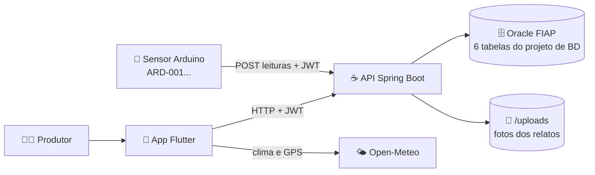
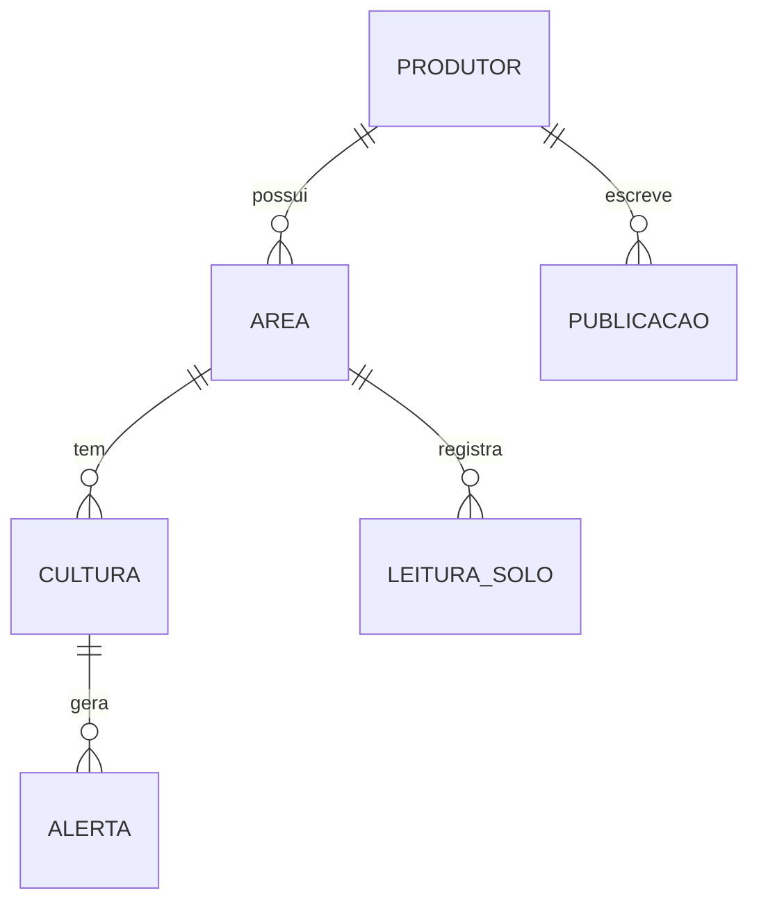

# 🌱 AgroSync API

> **API REST do AgroSync** — plataforma CitizenTech para pequenos produtores de hortaliças e frutas.
> **FIAP · Global Solution 2026/2 · Java Advanced** · Java 21 · Spring Boot 3.5 · Oracle

O AgroSync ajuda o pequeno produtor rural a decidir **quando irrigar, colher ou proteger a lavoura**, reunindo em um só lugar o monitoramento da umidade do solo, alertas, controle de irrigação e uma comunidade de troca de experiências. Esta API é o "cérebro" da solução: grava nas **mesmas tabelas Oracle** do projeto de Banco de Dados, aplica a **mesma regra de severidade** e é consumida pelo **aplicativo Flutter** (repositório `agrosync`).

---

## 👥 Equipe e links

| Nome | RM | Turma |
|------|----|-------|
| Alan Christopher | 567033 | 2TDSPA |
| Guilherme Sena | RM568101 | 2TDSPA |
| Igor Dantas | RM568337 | 2TDSPA |

- 🎬 **Vídeo pitch:** _colar o link aqui_
- 📱 **Aplicativo mobile (Flutter):** _colar o link do repositório aqui_
- 🗄️ **Banco de dados (Oracle/PL-SQL):** _colar o link do repositório aqui_

## 📑 Sumário
1. [Sobre o projeto](#-sobre-o-projeto)
2. [Alinhamento com o banco de dados](#-alinhamento-com-o-banco-de-dados)
3. [Regra de negócio central](#-regra-de-negócio-central)
4. [Tecnologias](#-tecnologias)
5. [Arquitetura e pastas](#-arquitetura-e-estrutura-de-pastas)
6. [Segurança](#-segurança)
7. [Endpoints](#-endpoints)
8. [Justificativa das consultas](#-justificativa-das-consultas)
9. [Como executar (Oracle)](#-como-executar-oracle)
10. [Como executar com Docker](#-como-executar-com-docker)
11. [Publicar sem Render: VM na nuvem](#-publicar-sem-render-vm-na-nuvem)
12. [Usuários de teste](#-usuários-de-teste)
13. [Integração com o app e com sensores](#-integração-com-o-app-e-com-sensores)
14. [Decisões técnicas e limitações](#-decisões-técnicas-e-limitações)
15. [Declaração de uso de IA generativa](#-declaração-de-uso-de-ia-generativa)

---

## 🌾 Sobre o projeto

**Problema.** Pequenos produtores perdem safra por falta de informação no momento certo: irrigação errada, chuva ou geada que não foram previstas, solo seco por dias. Dados de clima e sensores costumam estar fora do alcance de quem produz em pequena escala.

**Solução.** Um ecossistema em três partes: (1) **app Flutter** para o produtor; (2) **esta API**, que guarda áreas, culturas e leituras de umidade, gera alertas e mantém o feed da comunidade; (3) **sensor Arduino** (opcional) que envia leituras para a API.

**ODS:** 2 (Fome zero e agricultura sustentável), 9 (Indústria, inovação e infraestrutura), 10 (Redução das desigualdades), 11 (Cidades e comunidades sustentáveis) e 13 (Ação contra a mudança global do clima).



---

## 🧩 Alinhamento com o banco de dados

A API **não cria nem altera tabelas** (`ddl-auto=none`): ela usa as seis tabelas criadas pelo script do projeto de Banco de Dados, com os mesmos nomes, colunas, tipos permitidos e restrições.

| Tabela do banco | Entidade Java | Observações |
|-----------------|---------------|-------------|
| `PRODUTOR` | `Produtor` | nome, e-mail único, senha, **município e região** |
| `AREA` | `Area` | tamanho em **hectares**, **latitude e longitude** |
| `CULTURA` | `Cultura` | tipo `HORTALICA`/`FRUTA`; estágio `GERMINACAO`/`CRESCIMENTO`/`FLORACAO`/`COLHEITA`; data de plantio |
| `LEITURA_SOLO` | `LeituraSolo` | liga-se à **área** (o sensor mede o solo); origem `SENSOR`/`MANUAL`; `id_dispositivo` (ex.: `ARD-001`) |
| `ALERTA` | `Alerta` | liga-se à **cultura**; tipo `CLIMA`/`IRRIGACAO`/`UMIDADE`; severidade `CRITICO`/`MODERADO`/`NORMAL`; `lido` = `'S'`/`'N'` |
| `PUBLICACAO` | `Publicacao` | texto, cultura (texto), região, data e `confirmacoes` |



**Como cada decisão do banco aparece na API**
- *"A leitura liga-se à área, não à cultura"*: `POST /api/areas/{id}/leituras`. Se o produtor troca de cultura na área (`POST /api/areas/{id}/culturas`), o histórico de umidade continua válido.
- **`sp_registrar_leitura`** → `LeituraService.registrar`: valida se a área tem cultura (senão **409**), insere a leitura, classifica a severidade e gera o alerta **na mesma transação**; se algo falha, tudo é desfeito (rollback).
- **`sp_relatorio_produtor`** → `GET /api/relatorio` (nome, município, áreas, total de alertas, críticos e, por área, cultura, estágio e última umidade).
- **Restrições `CHECK`** → Bean Validation (umidade 0–100, tamanho > 0, latitude −90..90, longitude −180..180, enums) com resposta **400** e mensagem por campo.
- **Colunas que o banco não tem** (e que a API, portanto, não grava): papel do usuário e foto do relato. O **papel** (`ADMIN`/`PRODUTOR`) vem da configuração `app.security.admin-emails`; a **foto** fica em disco como `pub-{id}.jpg` e é ligada ao relato pelo nome do arquivo.
- **Senhas de teste em texto puro** (carga do script): continuam funcionando no login e são convertidas para **BCrypt** no primeiro acesso.

---

## 📐 Regra de negócio central

Classificação da umidade do solo, **igual** à do script PL/SQL e ao app:

| Umidade | Classificação | Alerta gerado | Ação recomendada |
|---------|---------------|---------------|------------------|
| abaixo de 20% | **CRÍTICO** | severidade `CRITICO` | Irrigação urgente. Risco alto de perda da safra. |
| de 20% até menos de 35% | **MODERADO** | severidade `MODERADO` | Irrigar nas próximas 24 horas. |
| de 35% até 70% | **NORMAL** | severidade `NORMAL` | Umidade adequada. Manter monitoramento. |
| acima de 70% | **EXCESSO** | severidade `NORMAL`* | Solo encharcado. Suspender irrigação. |

\* A tabela `ALERTA` só aceita `CRITICO`, `MODERADO` ou `NORMAL`; por isso o alerta de excesso é gravado como `NORMAL` e a mensagem informa "solo encharcado, suspender irrigacao".

Outras regras: produtor só vê e altera **os próprios dados** (administrador vê todos); `confirmacoes` nunca fica abaixo de zero; e-mail é único (409 se repetido).

---

## 🛠️ Tecnologias

| Camada | Tecnologia |
|--------|-----------|
| Linguagem / Framework | Java 21 · Spring Boot 3.5 |
| API REST | Spring Web |
| Persistência | Spring Data JPA (Hibernate) · **Oracle** (padrão) · PostgreSQL (perfil `prod`, só Docker/nuvem) |
| Validação | Bean Validation (Jakarta) |
| Segurança | Spring Security · JWT (jjwt 0.12) · BCrypt · CORS |
| Documentação | Swagger / OpenAPI (springdoc 2.8) |
| Entrega | Docker (multi-stage, usuário não-root, healthcheck) · Docker Compose (API + PostgreSQL) |

> Por decisão do grupo, esta versão **não utiliza** Spring Cache, Spring HATEOAS nem Actuator.

---

## 🏗️ Arquitetura e estrutura de pastas

API em **camadas**: o controller só recebe/devolve HTTP, o service concentra as regras e o repository conversa com o banco. A entidade nunca é exposta: toda resposta usa **DTOs** (records).

```
src/main/java/br/com/fiap/agrosync/
├── AgroSyncApplication.java
├── DataLoader.java        # carga de exemplo (SÓ no perfil prod/Docker, com banco vazio)
├── config/                # SecurityConfig (JWT, CORS, rotas), OpenApiConfig, WebConfig (/uploads)
├── security/              # JwtService, JwtAuthFilter, UsuarioLogado, PapelResolver, LegacyPasswordEncoder
├── controller/            # Auth, Area, Cultura, Alerta, Publicacao, Relatorio, Status
├── service/               # regras de negócio (leitura, alerta, relatório, fotos...)
├── repository/            # Spring Data JPA (query methods e @Query)
├── spec/                  # Specifications (filtros dinâmicos)
├── domain/                # entidades (= tabelas do banco), enums, ClassificacaoUmidade
├── dto/                   # records de entrada/saída e ErroResposta
└── exception/             # exceções de negócio + handler global

Dockerfile · docker-compose.yml · .env.example
src/main/resources/application.properties        # Oracle (padrão)
src/main/resources/application-prod.properties   # PostgreSQL (Docker/nuvem)
```

---

## 🔐 Segurança

- **Senhas:** BCrypt, nunca devolvidas pela API.
- **JWT (HS256)** válido por 24 h, enviado em `Authorization: Bearer <token>`; API **stateless** (sem sessão/cookies).
- **Papéis:** `PRODUTOR` e `ADMIN`. Como a tabela `PRODUTOR` não tem coluna de papel, os e-mails de `app.security.admin-emails` (padrão: `admin@agrosync.com`) são `ADMIN`. Endpoints de admin usam `@PreAuthorize("hasRole('ADMIN')")`.
- **CORS** configurável (`CORS_ORIGINS`); respostas **401/403** em JSON padronizado.
- A chave JWT vem de `JWT_SECRET`; o valor padrão do `application.properties` é **só de desenvolvimento** (não é uma chave real).

| Recurso | Sem login | PRODUTOR | ADMIN |
|---------|:---------:|:--------:|:-----:|
| Registro, login, `/api/status`, Swagger, fotos | ✅ | ✅ | ✅ |
| Áreas, culturas, leituras, alertas, relatório (os próprios) | ❌ | ✅ | ✅ (todos) |
| Feed da comunidade | ❌ | ✅ | ✅ |
| Criar/excluir alertas | ❌ | ❌ | ✅ |

---

## 🔌 Endpoints

Swagger: **http://localhost:8080/swagger-ui.html**

| Método | Rota | Acesso | Descrição |
|--------|------|--------|-----------|
| GET | `/api/status` | público | confirma que a API está no ar |
| POST | `/api/auth/register` | público | cadastra produtor (nome, e-mail, senha, município, região) — 201 |
| POST | `/api/auth/login` | público | login; devolve o token |
| GET | `/api/auth/me` | autenticado | produtor logado |
| GET | `/api/areas` | autenticado | áreas com **cultura atual** e **última leitura** (filtro `nome`; `page`, `size`, `sort`) |
| POST | `/api/areas` | autenticado | cadastra área (+ cultura opcional) — 201 |
| GET / PUT / DELETE | `/api/areas/{id}` | dono ou admin | detalhe / atualiza / exclui (204, com culturas, alertas e leituras) |
| GET / POST | `/api/areas/{id}/culturas` | dono ou admin | lista / planta nova cultura |
| PUT / DELETE | `/api/culturas/{id}` | dono ou admin | edita / exclui a cultura |
| POST | `/api/areas/{id}/leituras` | dono ou admin | **registra leitura e gera o alerta** — 201 (409 se a área não tem cultura) |
| GET | `/api/areas/{id}/leituras` | dono ou admin | histórico paginado |
| POST | `/api/areas/{id}/irrigacoes` | dono ou admin | registra irrigação manual (alerta `IRRIGACAO`) |
| GET | `/api/alertas` | autenticado | lista (filtros `tipo`, `severidade`, `lido`) |
| GET | `/api/alertas/nao-lidos` | autenticado | contador |
| PATCH | `/api/alertas/{id}/lido` | dono ou admin | marca como lido |
| POST / DELETE | `/api/alertas`, `/api/alertas/{id}` | **ADMIN** | cria (para uma cultura, uma região ou todas) / exclui |
| GET | `/api/relatorio`, `/api/relatorio/{produtorId}` | próprio ou admin | relatório do produtor |
| GET | `/api/publicacoes` | autenticado | feed (filtros `regiao`, `busca`) |
| POST | `/api/publicacoes` | autenticado | publica — `multipart/form-data`: `texto`, `cultura`, `regiao`, `imagem` (opcional) |
| POST / DELETE | `/api/publicacoes/{id}/confirmar` | autenticado | soma / desfaz uma confirmação |
| DELETE | `/api/publicacoes/{id}` | autor ou admin | exclui o relato |
| GET | `/uploads/{arquivo}` | público | foto enviada |

**Paginação:** `{ "content": [...], "page": { "size": 20, "number": 0, "totalElements": 2, "totalPages": 1 } }`

**Erros** (sempre neste formato):
```json
{
  "timestamp": "2026-11-17T10:15:30",
  "status": 400,
  "error": "Bad Request",
  "message": "Dados inválidos.",
  "path": "/api/areas",
  "fieldErrors": [ { "campo": "tamanhoHa", "mensagem": "O tamanho deve ser maior que zero" } ]
}
```
Códigos: `200`, `201`, `204`, `400` (validação), `401`, `403`, `404`, `409` (regra de negócio), `413` (arquivo grande), `500`.

---

## 🔎 Justificativa das consultas

| Tipo | Onde | Por quê |
|------|------|---------|
| **Query method derivado** | `ProdutorRepository.findByEmailIgnoreCase`; `CulturaRepository.findFirstByAreaIdOrderByDataPlantioDescIdDesc` (cultura atual); `LeituraSoloRepository.findFirstByAreaIdOrderByDataHoraDescIdDesc` (última leitura) e `findByAreaIdOrderByDataHoraDescIdDesc(id, pageable)` (histórico) | consultas simples; o nome já documenta a regra e a paginação vem pronta |
| **JPQL (`@Query`)** | `AlertaRepository.contarPorProdutor` e `contarCriticosPorProdutor` | totais do relatório com navegação `ALERTA → CULTURA → AREA → PRODUTOR`, calculados pelo banco |
| **Specification** | `AreaSpecs`, `AlertaSpecs`, `PublicacaoSpecs` | filtros **opcionais e combináveis** (nome, tipo, severidade, lido, região, busca por texto/cultura/produtor) sem um método para cada combinação; a regra "produtor só vê o que é dele" entra como mais uma Specification |

O feed usa `@EntityGraph(attributePaths = "produtor")` para carregar o autor junto e evitar uma consulta por relato.

---

## ▶️ Como executar (Oracle)

**Requisitos:** JDK 21, Maven (ou uma IDE) e acesso ao **Oracle da FIAP**.

### 1) Crie as tabelas com o script do banco
Execute o script `gs_2026.sql` do projeto de Banco de Dados no seu schema (SQL Developer → **F5**). Ele cria as 6 tabelas, as restrições e a carga de teste. **A API não cria tabelas.**

### 2) Defina as credenciais do Oracle
```bash
# Linux / Mac
export DB_USER=SEU_RM
export DB_PASSWORD=SUA_SENHA_DO_ORACLE

# Windows (PowerShell)
$env:DB_USER="SEU_RM"
$env:DB_PASSWORD="SUA_SENHA_DO_ORACLE"
```
Na IDE, cadastre as duas variáveis na configuração de execução. URL padrão: `jdbc:oracle:thin:@oracle.fiap.com.br:1521:ORCL` (troque com `DB_URL`).

### 3) Rode a API
```bash
mvn spring-boot:run
```
Swagger: `http://localhost:8080/swagger-ui.html` → faça login em `/api/auth/login`, copie o `token` e clique em **Authorize**.

> **Erros comuns:** `Could not resolve placeholder 'DB_USER'` = variável não definida no terminal que roda o Maven · `ORA-00942: table or view does not exist` = o script `gs_2026.sql` ainda não foi executado neste schema · falha de conexão = confira RM/senha e se a sua rede alcança o banco (alguns exigem VPN/rede da FIAP).

### Variáveis de ambiente
| Variável | Para quê | Padrão |
|----------|----------|--------|
| `DB_USER` / `DB_PASSWORD` | Oracle (seu RM e senha) | **obrigatórias** |
| `DB_URL` | URL JDBC | `jdbc:oracle:thin:@oracle.fiap.com.br:1521:ORCL` |
| `JWT_SECRET` | chave do JWT (mín. 32 caracteres) | valor de desenvolvimento |
| `ADMIN_EMAILS` | e-mails com papel `ADMIN` (separados por vírgula) | `admin@agrosync.com` |
| `CORS_ORIGINS` | origens liberadas | `*` |
| `UPLOAD_DIR` | pasta das fotos | `uploads` |

---

## 🐳 Como executar com Docker

O Docker sobe a API **e um PostgreSQL** juntos, sem precisar do Oracle — ideal para demonstrar em qualquer máquina ou servidor. Nesse modo as tabelas são criadas automaticamente (mesmos nomes e colunas) e uma **carga de exemplo** é inserida.

```bash
cp .env.example .env            # preencha DB_PASSWORD e JWT_SECRET (nunca suba o .env)
docker compose up -d --build
```
- API: `http://localhost:8080` · Swagger: `/swagger-ui.html` · saúde: `/api/status`
- **2 containers** (`agrosync-api` e `agrosync-db`) na rede `agronet`; o banco usa **volume nomeado** (`pgdata`) e as fotos ficam no volume `uploads` — os dados **persistem** ao reiniciar.
- A API só inicia depois que o banco aceita conexões (`depends_on` + *healthcheck*).
- A imagem usa **build em duas etapas**, **usuário sem privilégios**, `WORKDIR /app`, variáveis de ambiente, porta 8080 exposta e `HEALTHCHECK`.

Comandos úteis:
```bash
docker compose ps                                  # estado e saúde dos containers
docker compose logs -f api                         # logs da API
docker exec -it agrosync-db psql -U agrosync -d agrosync   # entrar no banco
docker compose down                                # parar (dados mantidos)
docker compose down -v                             # parar e APAGAR os dados
```

---

## ☁️ Publicar sem Render: VM na nuvem

Como a API roda em Docker, ela funciona em **qualquer servidor** (VM do Azure, outra nuvem ou até um computador da sala). Vantagem sobre planos gratuitos de PaaS: a VM **fica sempre ligada** (a API não "dorme") e o disco é persistente (dados e fotos não se perdem).

Exemplo com **Azure CLI** (adapte nomes e região):
```bash
az group create --name rg-agrosync --location brazilsouth
az vm create --resource-group rg-agrosync --name vm-agrosync \
   --image Ubuntu2204 --size Standard_B2s --admin-username azureuser --generate-ssh-keys
az vm open-port --resource-group rg-agrosync --name vm-agrosync --port 8080
```
Na VM (via `ssh azureuser@IP_PUBLICO`):
```bash
curl -fsSL https://get.docker.com | sudo sh && sudo usermod -aG docker $USER   # reconecte o SSH depois
git clone <URL-do-repositório> && cd agrosync-api
cp .env.example .env && nano .env        # defina DB_PASSWORD e JWT_SECRET
docker compose up -d --build
```
No app, use **Ajustes → Alterar servidor** → `http://IP_PUBLICO:8080` e toque em **Testar conexão**. Para HTTPS em produção, coloque um proxy reverso (Caddy ou Nginx) com certificado na frente da API.

> Esses passos não foram executados no desenvolvimento do projeto: confirme tamanho da VM, região e custos no seu portal.

---

## 🧪 Usuários de teste

**Com o Oracle (após rodar `gs_2026.sql`):** os produtores da carga do banco, por exemplo
`jose.silva@email.com` / `senha123` (Mogi das Cruzes) ou `maria.santos@email.com` / `senha123`. Para testar o papel **ADMIN**, cadastre pelo Swagger/app uma conta com o e-mail `admin@agrosync.com` (esse e-mail é tratado como `ADMIN`).

**Com o Docker (carga de exemplo):**

| Papel | E-mail | Senha | O que pode |
|-------|--------|-------|-----------|
| `ADMIN` | admin@agrosync.com | `Admin@123` | tudo, inclusive criar/excluir alertas e ver os dados de todos |
| `PRODUTOR` | produtor@agrosync.com | `Produtor@123` | gerenciar as próprias áreas, ler alertas, publicar |
| `PRODUTOR` | maria@agrosync.com | `Produtor@123` | idem (testa o isolamento entre produtores) |
| `PRODUTOR` | carlos@agrosync.com | `Produtor@123` | idem |

São credenciais **apenas de teste**.

---

## 📱 Integração com o app e com sensores

**App Flutter:** padrão `http://10.0.2.2:8080` (o "localhost" do computador visto pelo emulador Android). Em celular físico, use o IP do computador ou da VM. O endereço é configurável no login e em **Ajustes**, onde o botão **Testar conexão** chama `GET /api/status`.

**Sensor Arduino:** autentica uma vez e envia leituras com o identificador do dispositivo:
```http
POST /api/areas/1/leituras
Authorization: Bearer <token>
Content-Type: application/json

{ "valorUmidade": 17.5, "origem": "SENSOR", "idDispositivo": "ARD-001" }
```
A API grava a leitura, classifica (aqui: **CRÍTICO**) e gera o alerta de umidade na mesma transação.

---

## ⚖️ Decisões técnicas e limitações

- **O banco é a referência:** modelo, nomes, tipos e regra de severidade seguem o script do projeto de BD; a API não altera o schema.
- **Dois bancos, dois perfis:** Oracle (padrão) para a entrega; PostgreSQL só no Docker. No Docker o Hibernate cria as tabelas (tipos/`CHECK` podem diferir do script Oracle).
- **Papel e foto fora do banco:** a tabela não tem esses campos (ver acima).
- **Confirmações ("Útil")** são só uma contagem; a tabela não guarda *quem* confirmou, então o app controla localmente quais relatos o usuário já confirmou.
- **Sem Spring Cache, HATEOAS e Actuator**, conforme decisão do grupo.
- Token com validade de 24 h, sem *refresh token*. Fotos em disco/volume (em produção, usar armazenamento de objetos).

---

## 🤖 Declaração de uso de IA generativa

> _Preencher com as ferramentas usadas e para quê (ex.: Claude para apoio na estruturação da API, alinhamento com o banco, revisão de código e documentação). O grupo revisou, testou e entende todo o código entregue._

---

*FIAP · Global Solution 2026/2 · CitizenTech*
