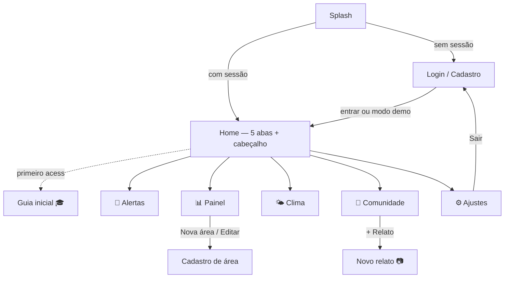

# 🌱 AgroSync — Aplicativo Mobile

> **Tecnologia com o cidadão no centro da inovação.**
> **FIAP · Global Solution 2026/2 · Mobile Application Development** · Flutter · Dart

O **AgroSync** é um aplicativo para **pequenos produtores de hortaliças e frutas** decidirem melhor *quando irrigar, colher ou proteger a lavoura*. Em um só lugar, o produtor acompanha a umidade e a temperatura do solo, controla a irrigação, consulta o clima da sua região, recebe alertas com orientação do que fazer e troca experiências (com fotos) com outros produtores.

O app conversa com a **API Java/Spring Boot** do projeto (repositório `agrosync-api`) e também funciona **sem servidor**, em *modo demonstração*.

---

## 👥 Equipe e links

| Nome | RM | Turma |
|------|----|-------|
| Alan Christopher | RM567033 | 2TDSPA |
| Guilherme Sena | RM568101 | 2TDSPA |
| Igor Dantas | RM568337 | 2TDSPA |

- 🎬 **Vídeo de demonstração (YouTube, não listado):** _https://www.youtube.com/watch?v=9McDCEEQf5g_
- ☕ **API (Java + Spring Boot):** _https://github.com/sena-guilherme/Global-Solution-2026-CitizenTech-/tree/main/02-java-api_

## 📑 Sumário
1. [Sobre o projeto](#-sobre-o-projeto)
2. [Telas e funcionalidades](#-telas-e-funcionalidades)
3. [Fluxo de navegação](#-fluxo-de-navegação)
4. [Tecnologias](#-tecnologias)
5. [Arquitetura e estrutura de pastas](#-arquitetura-e-estrutura-de-pastas)
6. [Gerenciamento de estado](#-gerenciamento-de-estado)
7. [Integração com a API](#-integração-com-a-api)
8. [Funcionamento offline e modo demonstração](#-funcionamento-offline-e-modo-demonstração)
9. [Como executar](#-como-executar)
10. [Requisitos da disciplina](#-requisitos-da-disciplina)
11. [Decisões e limitações](#-decisões-e-limitações)
12. [Declaração de uso de IA generativa](#-declaração-de-uso-de-ia-generativa)

---

## 🌾 Sobre o projeto

### O problema
Pequenos produtores perdem safra por falta de informação no momento certo: geada ou chuva forte que não foram previstas, solo seco por dias, excesso de irrigação que favorece fungos. Dados de clima, sensores e assistência técnica costumam estar fora do alcance de quem trabalha em pequena escala — muitas vezes com internet instável.

### Quem é beneficiado
Agricultores familiares e pequenos produtores de **hortaliças e frutas**, em qualquer região do Brasil.

### Como o app resolve
| Necessidade do produtor | O que o app oferece |
|-------------------------|---------------------|
| Saber se o solo precisa de água | Painel com a umidade do solo, **classificação** (crítico, moderado, normal, excesso) e a recomendação do que fazer |
| Não gastar água (nem encharcar) | Irrigação **automática** ou **manual**, com alertas de solo seco/encharcado |
| Antecipar clima ruim | Previsão de 3 dias, chuva, vento e alertas de geada, calor e chuva forte |
| Saber o que fazer | Alertas com **explicação e recomendação**, e FAQ |
| Aprender com outros produtores | Comunidade com relatos, fotos (câmera ou galeria) e botão "Útil" |
| Usar no campo, sem sinal | Últimos dados salvos no aparelho (clima, painel, alertas, feed) |

### ODS relacionados
- **ODS 2** — Fome zero e agricultura sustentável
- **ODS 9** — Indústria, inovação e infraestrutura
- **ODS 10** — Redução das desigualdades
- **ODS 11** — Cidades e comunidades sustentáveis
- **ODS 13** — Ação contra a mudança global do clima

---

## 📱 Telas e funcionalidades

O app tem **11 telas**. A navegação principal é por **5 abas**: Alertas · Painel · Clima · Comunidade · Ajustes.

| Tela | O que faz |
|------|-----------|
| **Splash** | Apresentação do app com degradê verde e barra de carregamento; já abre direto no app se houver sessão salva |
| **Login / Cadastro** | Entrar com e-mail e senha ou criar conta (nome, e-mail, senha, **município e região**); *modo demonstração* e endereço do servidor |
| **Guia inicial** | 3 passos em diálogo (com fotos); abre no primeiro acesso e pelo botão **Guia** do cabeçalho |
| **Alertas** | Lista com filtros por **tipo** (umidade, clima, irrigação) e **severidade**, alerta expansível com **"O que fazer"**, marcação de lido, FAQ e sobre o projeto |
| **Painel** | Escolha da **área**; indicadores do produtor (áreas, alertas, críticos); cultura com foto, estágio e dia do ciclo; modo de irrigação **Automático/Manual**; **registro de irrigação**; **umidade do solo** com classificação, **temperatura do ar** na região da área e **recomendação**; registro de leitura (formulário) e histórico |
| **Cadastro de área e cultura** | Cria ou edita a área (nome, **tamanho em hectares**, **latitude e longitude**, com botão de **GPS**) e a cultura plantada (tipo hortaliça/fruta, nome, data de plantio e estágio) |
| **Clima** | Busca por município ou **GPS**; temperatura, chuva, umidade do ar, vento; previsão de 3 dias; alertas derivados da previsão; **modo offline** |
| **Comunidade** | Feed com busca por produtor/cultura/região, filtro **"minha região"**, **"Útil"** (confirmações), paginação ("Carregar mais") e exclusão (autor/admin) |
| **Novo relato** | Formulário (texto, cultura e região) com **foto tirada na hora (câmera) ou escolhida da galeria** |
| **Ajustes** | Tema **claro/escuro**, **tamanho** e **família da fonte**, **servidor** (alterar endereço e testar conexão), rever guia, ODS e sair |

---

## 🧭 Fluxo de navegação



---

## 🛠️ Tecnologias

| Item | Uso |
|------|-----|
| **Flutter / Dart** (Material 3) | Interface e lógica do app |
| `http` | Comunicação com a API e com o serviço de clima |
| `shared_preferences` | Tema, fonte, sessão, endereço do servidor e **cache offline** |
| `image_picker` | **Câmera e galeria** para as fotos da comunidade |
| `geolocator` | Localização (GPS) para o clima |
| [Open-Meteo](https://open-meteo.com/) | Previsão do tempo e busca de municípios (gratuito, sem chave) |
| Pexels | Fotos ilustrativas (licença gratuita) |

---

## 🏗️ Arquitetura e estrutura de pastas

Separação simples em camadas: **páginas** (UI) → **repositories** (dados/API/cache) → **models** (estrutura dos dados).

```
lib/
├── main.dart                     # inicialização e tema/fonte globais
├── models/
│   ├── produtor_model.dart       # usuário logado (produtor/admin)
│   ├── area_model.dart           # Area, LeituraSolo, ClassificacaoUmidade, relatório
│   ├── cultura_model.dart        # Cultura, TipoCultura, Estagio
│   ├── alerta_model.dart         # Alerta e Severidade
│   └── publicacao_model.dart     # relato da comunidade
├── repositories/
│   ├── api_repository.dart       # API Java: login/JWT, áreas, leituras, alertas, comunidade, cache
│   ├── clima_repository.dart     # Open-Meteo + GPS + cache offline
│   ├── local_storage.dart        # preferências locais (tema, fonte, sessão, cache)
│   ├── demo_data.dart            # dados em memória do modo demonstração
│   └── api_exception.dart
├── theme/app_theme.dart          # temas claro/escuro e paleta
├── widgets/                      # custom_card, custom_button, image_picker_widget,
│                                 # app_header, foto_slot, pilula_seletor, servidor_dialog
├── pages/                        # splash, onboarding, login, home, alertas, painel,
│                                 # cadastro_area, clima, comunidade, novo_relato, configuracoes
└── utils/                        # helpers (formatação, SnackBar), imagens (URLs das fotos)
```

---

## 🖼️ Onde colocar suas imagens

O app tem **15 "espaços de imagem"** prontos. Para usar uma foto sua, salve o arquivo em `assets/imagens/` com o **nome indicado** e rode o app de novo — não é preciso mexer no código. Enquanto o arquivo não existir, o app usa uma foto padrão da internet e, sem conexão, um emoji.

| Arquivo | Onde aparece | Tipo de imagem que combina |
|---------|--------------|----------------------------|
| `logo.png` | splash, cabeçalho e login | PNG transparente, 512×512, broto/folha simples, sem texto |
| `login_topo.jpg` | topo do login | panorâmica de horta/plantação ao amanhecer ou agricultor(a) familiar |
| `guia_1_boas_vindas.jpg` | guia, passo 1 | horta ou estufa bem cuidada |
| `guia_2_alertas.jpg` | guia, passo 2 | céu carregado sobre a lavoura ou produtor olhando o celular |
| `guia_3_comunidade.jpg` | guia, passo 3 | pessoas colhendo ou conversando, feira local |
| `alertas_banner.jpg` | aba Alertas | céu dramático sobre a lavoura |
| `clima_banner.jpg` | aba Clima | céu aberto com sol e nuvens sobre o campo |
| `comunidade_banner.jpg` | aba Comunidade | mãos segurando a colheita / plantio em grupo |
| `cultura_hortalica.jpg` | Painel (tipo hortaliça) | close de folhas em canteiro |
| `cultura_fruta.jpg` | Painel (tipo fruta) | frutas maduras no pé |
| `relato_demo_1.jpg`, `relato_demo_2.jpg` | relatos do modo demonstração | canteiro com sombrite; tomate/morango irrigado |
| `vazio_areas.png`, `vazio_alertas.png`, `vazio_relatos.png` | telas vazias | ilustração simples em tons de verde, fundo transparente |

Tamanhos sugeridos e dicas estão em `assets/imagens/LEIAME.txt` e, com a descrição de cada espaço, em `lib/utils/imagens.dart`.

---

## 🔄 Gerenciamento de estado

Todo o estado da interface usa **`StatefulWidget` + `setState()`**, como visto em aula:

- **Raiz do app** (`AgroSyncAppState`): guarda tema (claro/escuro), tamanho e família da fonte; ao mudar, o app inteiro é reconstruído e a escolha é salva no aparelho.
- **Telas**: cada página controla seu próprio carregamento, erro, filtros e listas (ex.: "Útil" atualiza na hora e desfaz se o servidor recusar).
- **Aviso de conexão**: um `ValueNotifier` mostra o banner "Sem conexão: exibindo os últimos dados salvos".

---

## 🔌 Integração com a API

Autenticação por **JWT**: o token recebido no login é enviado em `Authorization: Bearer <token>` e salvo no aparelho. Se expirar, o app volta ao login.

| Tela | Chamadas à API |
|------|----------------|
| Login/Cadastro | `POST /api/auth/login`, `POST /api/auth/register` |
| Painel | `GET/POST/PUT/DELETE /api/areas` (área + cultura), `GET/POST /api/areas/{id}/leituras`, `POST /api/areas/{id}/irrigacoes`, `GET /api/relatorio` |
| Alertas | `GET /api/alertas` (filtros `tipo` e `severidade`), `PATCH /api/alertas/{id}/lido` |
| Comunidade | `GET /api/publicacoes`, `POST /api/publicacoes` (*multipart* com foto), `POST` e `DELETE /api/publicacoes/{id}/confirmar`, `DELETE /api/publicacoes/{id}` |
| Ajustes | `GET /api/status` (Testar conexão) |

Erros da API chegam em JSON padronizado e o app mostra a mensagem para o usuário (campos inválidos, regra de negócio, permissão etc.).

---

## 🧩 Alinhamento com o banco de dados

O app, a API e o banco de dados (Oracle/PL-SQL) formam **uma única solução**: os dados do app são gravados pela API nas **mesmas seis tabelas** do projeto de Banco de Dados.

| Tabela do banco | No app |
|-----------------|--------|
| `PRODUTOR` | cadastro/login (nome, e-mail, senha, **município e região**) |
| `AREA` | cadastro de área: nome, **tamanho em hectares**, **latitude e longitude** |
| `CULTURA` | cultura plantada: tipo **hortaliça/fruta**, nome, data de plantio e estágio **germinação / crescimento / floração / colheita** |
| `LEITURA_SOLO` | histórico de leituras de umidade (origem sensor ou manual, com o dispositivo, ex.: `ARD-001`) |
| `ALERTA` | tela Alertas: tipo **clima / irrigação / umidade** e severidade **crítico / moderado / normal** |
| `PUBLICACAO` | Comunidade: texto, cultura, região e confirmações ("Útil") |

**Regra de severidade da umidade do solo** (a mesma do banco e da API):

| Umidade | Classificação | Ação recomendada |
|---------|---------------|------------------|
| abaixo de 20% | **Crítico** | Irrigação urgente. Risco alto de perda da safra. |
| 20% até menos de 35% | **Moderado** | Irrigar nas próximas 24 horas. |
| 35% até 70% | **Normal** | Umidade adequada. Manter monitoramento. |
| acima de 70% | **Excesso** | Solo encharcado. Suspender irrigação. |

**O que o banco não guarda** (e como o app resolve): o **modo Automático/Manual** de irrigação e **quais relatos você já marcou como "Útil"** ficam salvos **neste aparelho**; a **foto** do relato é guardada pela API em disco e ligada ao relato pelo nome do arquivo.

---

## 📶 Funcionamento offline e modo demonstração

- **Cache automático:** toda consulta bem-sucedida (áreas, leituras, alertas, feed) é guardada; sem rede, o app mostra o último dado salvo com aviso.
- **Clima offline:** abre com a última previsão consultada e informa a data/hora dela.
- **Modo demonstração:** botão na tela de login que usa dados em memória, **sem precisar de servidor**, mantendo as mesmas regras (alertas por umidade, irrigação automática, curtidas, publicação com foto etc.). Ideal para apresentação.

---

## ▶️ Como executar

Este repositório contém o código do app (`lib/`, `pubspec.yaml`). As pastas `android/` e `ios/` são geradas pelo Flutter:

```bash
flutter create agrosync_base --org br.com.fiap --project-name agrosync --platforms=android,ios
# copie para dentro de agrosync_base/ (substituindo): lib/, pubspec.yaml, analysis_options.yaml
cd agrosync_base
flutter pub get
flutter run
```

### Permissões

**Android** — `android/app/src/main/AndroidManifest.xml`:
```xml
<manifest ...>
    <uses-permission android:name="android.permission.INTERNET"/>
    <uses-permission android:name="android.permission.ACCESS_COARSE_LOCATION"/>
    <uses-permission android:name="android.permission.ACCESS_FINE_LOCATION"/>

    <!-- na tag <application> existente (permite http:// em desenvolvimento) -->
    <application ... android:usesCleartextTraffic="true">
```

**iOS** — `ios/Runner/Info.plist` (dentro de `<dict>`):
```xml
<key>NSCameraUsageDescription</key><string>Tirar fotos dos relatos da sua lavoura.</string>
<key>NSPhotoLibraryUsageDescription</key><string>Escolher fotos para os relatos.</string>
<key>NSLocationWhenInUseUsageDescription</key><string>Mostrar o clima da sua localização.</string>
<key>NSAppTransportSecurity</key><dict><key>NSAllowsArbitraryLoads</key><true/></dict>
```

### Conectando à API
1. Suba a API (`agrosync-api`, porta 8080).
2. Endereço do servidor (ícone de rede no login ou **Ajustes → Alterar servidor**):
   - **Emulador Android:** `http://10.0.2.2:8080` *(padrão)*
   - **Celular físico:** `http://IP-DO-SEU-PC:8080` (mesmo Wi-Fi; libere a porta 8080 no firewall)
3. Use **Ajustes → Testar conexão** para conferir.
   - **API publicada na nuvem:** use a URL `https://...` do servidor (planos gratuitos podem "dormir"; abra `/api/status` no navegador antes de usar).
4. Entre com um usuário de teste da API (veja o README da API) ou crie uma conta informando município e região.
5. Sem servidor? Toque em **Entrar em modo demonstração**.

---

## ✅ Requisitos da disciplina

| Requisito | Onde está |
|-----------|-----------|
| **Navegação** (≥ 5 telas, parâmetros) | `Navigator.push`/`pushReplacement`; 11 telas; `CadastroAreaPage(area)` recebe a área a editar; `NavigationBar` com 5 abas |
| **Protótipo visual** | Scaffold, AppBar, Column, Row, Container, Padding, SizedBox, Card, Image, Icon, ListView; tema Material 3 consistente (cores, tipografia, espaçamentos) |
| **Gerenciamento de estado** | `StatefulWidget` + `setState()` em todas as telas |
| **Formulário e validação** | `Form` + `GlobalKey<FormState>` em login, cadastro de área, leitura, novo relato; feedback com `SnackBar` e `AlertDialog` |
| **Histórico do Git** | commits pequenos e frequentes, mensagens claras em um único idioma |
| **Vídeo** | demonstração no emulador/dispositivo (não no navegador), narrada, até 5 min, YouTube não listado |
| **README** | solução, cidadão beneficiado, ODS e declaração de IA (este arquivo) |

---

## ⚖️ Decisões e limitações

- **Login com Google:** não foi incluído porque exige configurar OAuth (Google Cloud/Firebase); o app usa e-mail/senha com JWT.
- **Token** salvo em `shared_preferences`; em produção, preferir `flutter_secure_storage`.
- **HTTP sem TLS** só para desenvolvimento; em produção usar HTTPS e remover `usesCleartextTraffic`.
- **Imagens:** as suas ficam em `assets/imagens/` (funcionam offline). Sem o arquivo, o app usa uma foto padrão da internet (Pexels), que precisa de conexão e não fica em cache; se falhar, mostra um fundo verde com emoji.
- **Emojis** são usados nos ícones das abas e rótulos para manter o visual do protótipo.
- O clima por GPS usa um serviço gratuito de geocodificação reversa; se falhar, mostra "Minha localização".

---

## 🤖 Declaração de uso de IA generativa

> _Preencher com as ferramentas usadas e para quê (ex.: Gemini para o protótipo inicial das telas; Claude para refinar o visual, integrar com a API Java e escrever a documentação). O grupo revisou, testou e entende todo o código entregue._

---

*FIAP · Global Solution 2026/2 · CitizenTech*
