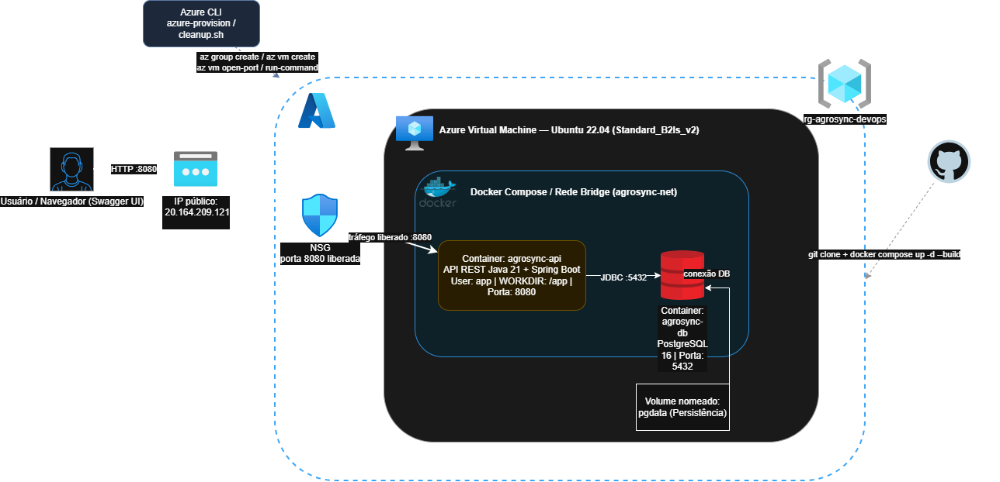

# AgroSync — Global Solution 2026/2 | CitizenTech · DevOps Tools & Cloud Computing

**FIAP · 2º Ano — Análise e Desenvolvimento de Sistemas (2TDSPA)**  
**Tema:** CitizenTech — Monitoramento e Gestão Colaborativa de Áreas Agrícolas e Comunitárias

---

## 👥 Integrantes do Grupo

| Nome | RM | Turma |
| :--- | :--- | :--- |
| **Alan Christopher Miranda** | 567033 | 2TDSPA |
| **Guilherme Santos Sena** | 568101 | 2TDSPA |
| **Igor Dantas da Silva** | 568337 | 2TDSPA |

---

## 📌 Sobre a Solução

O **AgroSync** é uma plataforma CitizenTech voltada ao registro, monitoramento e gestão colaborativa de áreas agrícolas e comunitárias. A aplicação utilizada nesta infraestrutura é a API RESTful desenvolvida em **Java 21 + Spring Boot**, contendo:
* Autenticação e autorização via **JWT (Spring Security)**.
* **CRUD completo** integrado a banco de dados relacional (**PostgreSQL 16**).
* **Relacionamento entre tabelas** gerenciado via JPA/Hibernate (ex.: entidades `usuario` e `area` vinculadas por chave estrangeira, além de registros associados).
* Documentação interativa via **Swagger UI / OpenAPI** exposta publicamente na nuvem.

---

## 🏛️ Arquitetura Macro da Solução



### Fluxo da Arquitetura em Nuvem:
1. **Cliente Externo (Navegador / Swagger UI):** Envia requisições HTTP REST para o IP Público da Azure (`20.164.209.121`) na porta `8080`.
2. **Network Security Group (NSG):** Firewall gerenciado do Microsoft Azure com regra de entrada liberada na porta TCP `8080`.
3. **Azure Virtual Machine (`vm-agrosync`):** Instância Ubuntu 22.04 LTS (`Standard_B2ls_v2`) provisionada via Azure CLI no Resource Group `rg-agrosync-devops`.
4. **Docker Engine & Rede Bridge Isolada (`agrosync-net`):** Comunicação interna segura entre os serviços conteinerizados.
5. **Container da Aplicação (`agrosync-api`):** Build multi-stage (Maven + Eclipse Temurin JRE 21), rodando em background (`-d`), com `WORKDIR /app`, usuário sem privilégios de root (`USER app`), variáveis de ambiente e `HEALTHCHECK` ativo na porta `8080`.
6. **Container do Banco de Dados (`agrosync-db`):** PostgreSQL 16 rodando em background com porta `5432` configurada, variáveis de ambiente e **volume nomeado** (`pgdata`) garantindo persistência dos dados mesmo após a recriação do container.

---

## 📁 Estrutura do Repositório (`04-devops/`)

```text
04-devops/
├── docs/
│   └── arquitetura.png          # Diagrama oficial da arquitetura (Azure + Docker)
├── scripts/
│   ├── azure-provision.sh       # Script Azure CLI para criação do RG, VM e abertura de porta
│   └── cleanup.sh               # Script Azure CLI para destruição completa dos recursos
├── src/                         # Código-fonte da API Java 21 / Spring Boot (CRUD + Relacionamentos)
├── .dockerignore                # Exclusão de arquivos desnecessários no contexto de build
├── .env.example                 # Template de variáveis de ambiente (sem dados sensíveis)
├── .gitignore                   # Proteção contra versionamento de .env e target/
├── docker-compose.yml           # Orquestração dos containers (api + db), network, volumes e healthcheck
├── Dockerfile                   # Build multi-stage com usuário não-root (app), WORKDIR e ENV
├── pom.xml                      # Dependências Maven (Spring Boot, JPA, PostgreSQL, Security, OpenAPI)
└── README.md                    # Documentação completa, How To e Evidências
```

---

## ☁️ Comandos Azure CLI Utilizados (Provisionamento IaC)

Todos os recursos em nuvem foram criados de forma reproduzível via **Azure CLI** (disponíveis em `scripts/azure-provision.sh`):

```bash
# 1. Autenticação na conta Microsoft Azure
az login

# 2. Criação do Resource Group
az group create --name rg-agrosync-devops --location southafricanorth

# 3. Provisionamento da Virtual Machine Ubuntu 22.04 LTS
az vm create \
  --resource-group rg-agrosync-devops \
  --name vm-agrosync \
  --image Canonical:0001-com-ubuntu-server-jammy:22_04-lts-gen2:latest \
  --size Standard_B2ls_v2 \
  --admin-username azureuser \
  --generate-ssh-keys \
  --public-ip-sku Standard

# 4. Liberação da porta 8080 no Network Security Group (NSG)
az vm open-port --resource-group rg-agrosync-devops --name vm-agrosync --port 8080 --priority 1010

# 5. Consulta do IP Público atribuído à VM
az vm show -d -g rg-agrosync-devops -n vm-agrosync --query publicIps -o tsv

# 6. Limpeza / Exclusão dos recursos após os testes (scripts/cleanup.sh)
az group delete --name rg-agrosync-devops --yes --no-wait
```

---

## 🚀 How To — Instruções de Execução Passo a Passo

### Pré-requisitos
* Conta ativa no Microsoft Azure com **Azure CLI** instalado.
* Cliente **SSH** e **Git**.

### 1. Provisionar a Infraestrutura no Azure
Execute o script de provisionamento no Azure Cloud Shell ou terminal local:
```bash
bash scripts/azure-provision.sh
```
*(Anote o IP Público exibido ao final da execução).*

### 2. Conectar na VM e Instalar Docker + Docker Compose
```bash
ssh azureuser@<IP-PUBLICO-DA-VM>

# Instalação oficial do Docker Engine e plugin Docker Compose
curl -fsSL https://get.docker.com | sudo sh
sudo usermod -aG docker $USER
exit
```
*(Reconecte via `ssh azureuser@<IP-PUBLICO-DA-VM>` para aplicar a permissão do grupo `docker`).*

### 3. Clonar o Repositório e Configurar Variáveis de Ambiente
```bash
git clone https://github.com/alanchristophermiranda2005-coder/Global-Solution-2026-CitizenTech-.git
cd Global-Solution-2026-CitizenTech-/04-devops

# Criar arquivo .env a partir do template e definir DB_PASSWORD e JWT_SECRET
cp .env.example .env
nano .env
```

### 4. Subir os Containers em Background (`-d`)
```bash
docker compose up -d --build
```

### 5. Validar Status, Saúde e Acesso Público
```bash
# Verificar status dos containers (api e db devem constar como Up / healthy)
docker compose ps

# Testar endpoint de status localmente
curl -i http://localhost:8080/api/status
```
**Acesso Externo (Swagger UI via IP Público da Azure VM):**
```text
http://20.164.209.121:8080/swagger-ui.html
```

---

## 🔍 Evidências Técnicas e Comandos de Auditoria

Para comprovar os requisitos de segurança, isolamento, persistência e funcionamento exigidos:

### 1. Logs dos Containers
```bash
docker compose logs --tail 30 api
docker compose logs --tail 30 db
```

### 2. Execução Interna, Usuário Não-Root (`app`) e `WORKDIR` (`/app`)
```bash
# Comprovação de usuário sem privilégios de root (retorna: app)
docker exec -it agrosync-api whoami

# Comprovação do diretório de trabalho configurado no Dockerfile (retorna: /app)
docker exec -it agrosync-api pwd

# Listagem dos arquivos e volume de uploads dentro do container
docker exec -it agrosync-api ls -la
```

### 3. Consulta Direta no Banco de Dados (`SELECT` no PostgreSQL)
```bash
# Acesso ao container do banco e consulta às tabelas populadas pelo CRUD
docker exec -it agrosync-db psql -U agrosync -d agrosync -c "\dt"
docker exec -it agrosync-db psql -U agrosync -d agrosync -c "SELECT * FROM usuario;"
docker exec -it agrosync-db psql -U agrosync -d agrosync -c "SELECT * FROM area;"
```

### 4. Teste de Persistência com Volume Nomeado
```bash
# Remover apenas o container do banco (mantendo o volume nomeado intacto)
docker compose rm -sf db

# Recriar e subir novamente o container do banco
docker compose up -d db

# Confirmar que os registros inseridos permanecem salvos no banco
docker exec -it agrosync-db psql -U agrosync -d agrosync -c "SELECT * FROM area;"
```

---

## 🎥 Link do Vídeo de Demonstração

* **Demonstração Completa (YouTube — Não Listado):** `[INSERIR_LINK_DO_YOUTUBE_AQUI]`